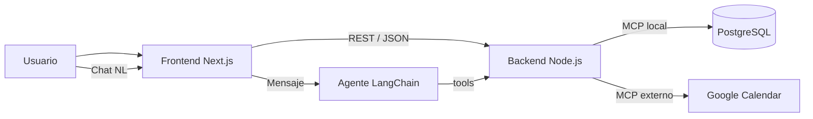
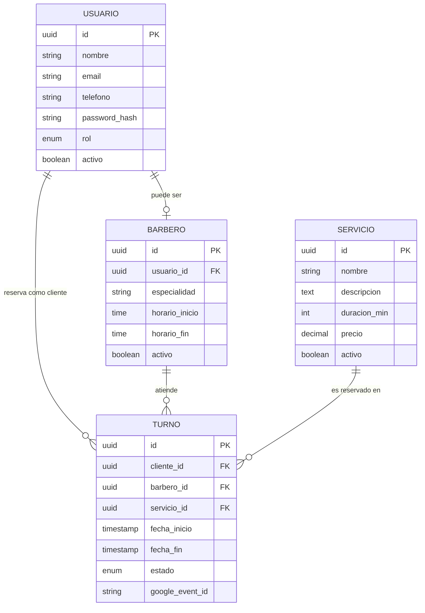

# SDD.md — System Design Document

> Sistema Integral de Gestión y Reservas para Barbería
> **Versión:** 1.0 — Fase de Especificación (SDD)
> **Rol autor:** Arquitecto / Tech Lead
> **Estado:** Borrador para revisión
> **Metodología:** Spec-Driven Development — ver `IA_WORKFLOW.md`

---

## 0. Propósito del Documento

Este documento define la **arquitectura de alto nivel**, el **modelo de datos** y la **estructura de carpetas** del sistema. Es la base sobre la cual se redactarán las specs por feature (`/specs/spec-<feature>.md`) y, posteriormente, el código.

**Alcance:** diseño técnico y organizativo. **No contiene código fuente.**

---

## 1. Resumen de la Arquitectura

### 1.1 Visión General

El sistema es una aplicación web cliente-servidor con un asistente conversacional. Se organiza en cuatro capas principales:

| Capa | Tecnología | Responsabilidad |
|------|------------|-----------------|
| Presentación | Next.js (App Router) + Tailwind CSS | UI, agenda, panel de gestión y chat del asistente |
| Aplicación / API | Node.js (API REST) | Lógica de negocio, validaciones, orquestación y autenticación |
| Dominio IA | LangChain (agente + tools) | Interpretar lenguaje natural y ejecutar acciones (reservar, consultar) |
| Integración / Datos | MCP (PostgreSQL local, Google Calendar externo) | Persistencia y sincronización de la agenda |

**Principios de arquitectura:**
- **Separación de capas:** la UI nunca accede a la base de datos directamente; siempre vía API.
- **Contratos primero:** Backend y Frontend se comunican únicamente mediante contratos de API versionados en las specs.
- **El chatbot no es un camino alternativo a la lógica:** el agente reutiliza los mismos servicios de negocio que la API (no duplica reglas).
- **Integraciones desacopladas:** PostgreSQL y Google Calendar se acceden vía MCP, de modo que la fuente de datos sea intercambiable.

### 1.2 Componentes

1. **Frontend (Next.js):** renderizado de la agenda, gestión de clientes/servicios/barberos, panel de métricas y widget de chat.
2. **Backend (Node.js):** expone la API REST; contiene los servicios de negocio (reservas, disponibilidad, clientes, catálogo, métricas) y las validaciones.
3. **Agente LangChain:** recibe el mensaje del usuario, decide qué `tools` invocar y devuelve una respuesta en lenguaje natural. Las `tools` llaman a los servicios del backend.
4. **MCP PostgreSQL (local):** operaciones de lectura/escritura sobre la base de datos.
5. **MCP Google Calendar (externo):** creación, consulta y actualización de eventos de turnos en la agenda externa.

### 1.3 Flujo de Datos



**Flujo de reserva (alto nivel):**
1. El usuario interactúa por la UI o por el chat.
2. La petición llega al backend (directo o vía `tool` del agente).
3. El backend valida disponibilidad y reglas de negocio, y persiste el turno.
4. Se sincroniza el evento con Google Calendar.
5. Se devuelve la confirmación a la UI / al chat.

### 1.4 Decisiones y Trade-offs

| Decisión | Justificación | Riesgo / Mitigación |
|----------|---------------|---------------------|
| MCP para PostgreSQL | Desacopla la persistencia y facilita el desarrollo guiado por IA | Overhead de abstracción; documentar bien las operaciones expuestas |
| Google Calendar vía MCP externo | Mantiene la agenda externa sincronizada sin lógica de bajo nivel en el backend | Dependencia de red/API; manejar reintentos y errores |
| Chatbot que reutiliza servicios | Evita duplicar reglas de negocio | Requiere que las `tools` sean finas y delegen en el backend |

---

## 2. Modelo de Datos

### 2.1 Entidades Principales

#### Usuario
Representa a una persona que accede al sistema (cliente o staff).

| Campo | Tipo | Descripción |
|-------|------|-------------|
| `id` | UUID / PK | Identificador único |
| `nombre` | string | Nombre completo |
| `email` | string (unique) | Correo / credencial de acceso |
| `telefono` | string | Contacto |
| `password_hash` | string | Contraseña hasheada (nunca en texto plano) |
| `rol` | enum(`cliente`, `barbero`, `admin`) | Rol y permisos |
| `activo` | boolean | Estado de la cuenta |
| `created_at` | timestamp | Fecha de alta |
| `updated_at` | timestamp | Última modificación |

#### Barbero
Profesional que atiende turnos. Extiende datos de un `Usuario` con rol `barbero`.

| Campo | Tipo | Descripción |
|-------|------|-------------|
| `id` | UUID / PK | Identificador único |
| `usuario_id` | FK → Usuario | Vínculo con la cuenta de usuario |
| `especialidad` | string | Especialidad o descripción |
| `horario_inicio` | time | Inicio de jornada |
| `horario_fin` | time | Fin de jornada |
| `dias_laborales` | int[] | Días de la semana (0–6) |
| `activo` | boolean | Disponibilidad para recibir turnos |

#### Servicio
Cada prestación ofrecida por la barbería.

| Campo | Tipo | Descripción |
|-------|------|-------------|
| `id` | UUID / PK | Identificador único |
| `nombre` | string | Nombre del servicio (ej. Corte clásico) |
| `descripcion` | text | Detalle del servicio |
| `duracion_min` | int | Duración estimada en minutos |
| `precio` | decimal(10,2) | Precio |
| `activo` | boolean | Si está visible para reservar |

#### Turno
Reserva de un servicio con un barbero en una fecha/hora concreta.

| Campo | Tipo | Descripción |
|-------|------|-------------|
| `id` | UUID / PK | Identificador único |
| `cliente_id` | FK → Usuario | Cliente que reserva |
| `barbero_id` | FK → Barbero | Profesional asignado |
| `servicio_id` | FK → Servicio | Servicio reservado |
| `fecha_inicio` | timestamp | Inicio del turno |
| `fecha_fin` | timestamp | Fin del turno |
| `estado` | enum(`pendiente`, `confirmado`, `cancelado`, `completado`) | Estado del turno |
| `notas` | text | Observaciones opcionales |
| `google_event_id` | string (nullable) | ID del evento sincronizado en Google Calendar |
| `created_at` | timestamp | Fecha de creación |
| `updated_at` | timestamp | Última modificación |

#### CredencialPasskey

Credencial WebAuthn (passkey) asociada a un `Usuario` (ver `spec-cu01`).

| Campo | Tipo | Descripción |
|-------|------|-------------|
| `id` | UUID / PK | Identificador único |
| `usuario_id` | FK → Usuario | Dueño de la credencial |
| `credential_id` | string (unique) | ID base64url de la credencial WebAuthn |
| `public_key` | text | Clave pública (base64url) |
| `counter` | int | Contador de uso (anti-replay) |
| `transports` | string[] | Transportes soportados |
| `created_at` | timestamp | Fecha de alta |

### 2.2 Relaciones



**Cardinalidades:**
- `Usuario 1 : 0..1 Barbero` — un usuario puede ser barbero como máximo una vez.
- `Usuario 1 : N Turno` — un cliente puede tener muchos turnos.
- `Barbero 1 : N Turno` — un barbero atiende muchos turnos.
- `Servicio 1 : N Turno` — un servicio puede estar en muchos turnos.
- `Usuario 1 : N CredencialPasskey` — un usuario puede tener varias passkeys.

### 2.3 Reglas de Integridad (alto nivel)

- No debe existir **solapamiento de turnos** para un mismo barbero.
- `fecha_fin` = `fecha_inicio` + `duracion_min` del servicio (o duración acordada).
- `email` de Usuario es **único**.
- Un `Turno` solo puede `google_event_id` si su estado es `confirmado` o superior.
- Borrado lógico preferido (`activo`) para preservar historial de turnos.

> Las reglas de negocio detalladas se especificarán por feature en `/specs`.

---

## 3. Estructura de Carpetas Propuesta

### 3.1 Estructura General del Repositorio

```text
Proyecto_Barberia/
├── AGENTS.md
├── IA_WORKFLOW.md
├── SDD.md
├── .instructions.md
├── docs/                 # diagramas, ADRs, documentación técnica
├── specs/                # especificaciones SDD por feature
│   └── spec-<feature>.md
├── frontend/             # aplicación Next.js
└── backend/              # servidor Node.js + agente LangChain + MCP
```

### 3.2 Frontend (Next.js + Tailwind)

```text
frontend/
├── public/
├── src/
│   ├── app/                          # App Router
│   │   ├── layout.tsx
│   │   ├── page.tsx                  # Landing / dashboard
│   │   ├── agenda/                   # Calendario de turnos
│   │   ├── clientes/                 # Gestión de clientes
│   │   ├── servicios/                # Catálogo de servicios
│   │   ├── barberos/                 # Panel de barberos
│   │   ├── metricas/                 # Panel de métricas
│   │   └── reservar/                 # Flujo de reserva paso a paso
│   ├── components/                   # Componentes reutilizables
│   │   ├── ui/                       # Botones, inputs, modales, etc.
│   │   ├── agenda/
│   │   ├── chat/                     # Interfaz del asistente
│   │   └── layout/                   # Navbar, sidebar, etc.
│   ├── lib/
│   │   ├── api/                      # Cliente HTTP y servicios de API
│   │   ├── hooks/                    # Custom hooks
│   │   └── utils/                    # Utilidades
│   ├── types/                        # Tipos compartidos (contratos)
│   └── styles/                       # Estilos/tokens de Tailwind
├── tailwind.config.*
├── next.config.*
├── tsconfig.json
└── package.json
```

### 3.3 Backend (Node.js + LangChain + MCP)

```text
backend/
├── src/
│   ├── api/
│   │   ├── routes/                   # Definición de endpoints
│   │   ├── controllers/              # Adaptadores HTTP
│   │   └── middlewares/              # Auth, validación, errores, logs
│   ├── services/                     # Lógica de negocio
│   │   ├── reservas.service.ts
│   │   ├── clientes.service.ts
│   │   ├── servicios.service.ts
│   │   ├── barberos.service.ts
│   │   └── metricas.service.ts
│   ├── data/                         # Acceso a datos (repositorios)
│   │   └── repositories/
│   ├── agent/                        # Chatbot LangChain
│   │   ├── agent.ts                  # Configuración del agente
│   │   ├── prompts/                  # Prompts del sistema
│   │   └── tools/                    # Tools que llaman a los services
│   ├── mcp/                          # Integración Model Context Protocol
│   │   ├── postgres/                 # MCP local (PostgreSQL)
│   │   └── google-calendar/          # MCP externo (Google Calendar)
│   ├── config/                       # Configuración y variables de entorno
│   ├── types/                        # Tipos/contratos compartidos
│   └── utils/                        # Utilidades y helpers
├── tests/
│   ├── unit/
│   └── integration/
├── .env.example
├── tsconfig.json
└── package.json
```

**Convenciones:**
- **Una responsabilidad por carpeta:** rutas no contienen lógica de negocio; los servicios no conocen HTTP.
- **Contratos en `types/`:** los tipos de request/response se derivan de las specs.
- **Tools finas:** cada `tool` de LangChain valida su entrada y delega en un `service`.
- **MCP encapsulado:** ningún módulo fuera de `mcp/` habla directamente con la base de datos o la API de Google.

---

## 4. Próximos Pasos (Flujo SDD)

1. **Revisión y aprobación** de este SDD por parte del usuario (GATE de especificación).
2. Redactar las specs por feature en `/specs` (empezando por **Reserva de Turnos**).
3. Definir contratos de API concretos (request/response) y las `tools` del agente.
4. Recién entonces iniciar la implementación (Paso 3 del `IA_WORKFLOW.md`).

> **Este documento no habilita la escritura de código.** La implementación comienza cuando existan specs por feature aprobadas.
