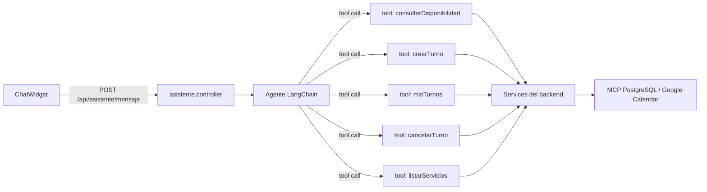

# Implementation Plan: Asistente Conversacional (LangChain + RAG)

**Branch**: `006-chatbot-langchain` | **Date**: 2026-10-20 | **Spec**: [spec.md](./spec.md)

**Input**: Feature specification from `/specs/006-chatbot-langchain/spec.md`

## Summary

Asistente conversacional con LangChain.js: fase 1 RAG de consulta (servicios, precios, horarios) sobre un archivo de conocimiento Markdown; fase 2 tool calling real sobre los services del backend con `usuarioId` de sesión, confirmación antes de escrituras y resiliencia. `ChatWidget` está integrado; el incremento `014-chat-reinicio-conversacion` completa desde la UI el reinicio de historial requerido por FR-008. Siguen pendientes los tests del agente (CA-06.9) y las verificaciones end-to-end.

## Arquitectura de la Integración (LangChain ⇄ Backend)

**Principio:** el agente **nunca** accede a la base de datos ni a Google Calendar directamente. Solo usa `tools`; cada `tool` valida su entrada y delega en un `service` del backend (la misma capa que usa la API REST).



**Componentes del agente:**
- **LLM:** modelo de chat configurable (proveedor definido por el Tech Lead).
- **Prompt de sistema (`agent/prompts/system.ts`):** rol de recepcionista, tono cordial, idioma español, reglas de confirmación antes de crear/cancelar un turno, no inventar disponibilidad.
- **Tools (`agent/tools/*`):** funciones tipadas con esquema de entrada/salida.
- **Memoria:** historial de conversación acotado por sesión (buffer/summary memory), con `usuarioId` como contexto de identidad.
- **Orquestación:** agente de tipo *tool-calling*; el resultado de cada `tool` se devuelve estructurado al LLM.

**Seguridad de las tools:**
- Toda `tool` recibe el `usuarioId` de la sesión autenticada; **jamás** lo toma del texto del usuario.
- Las operaciones de escritura (crear/cancelar) requieren **confirmación explícita** del usuario en la conversación.
- Las tools reutilizan las validaciones de los services (no las reimplementan).

## Endpoints REST (Node.js)

| Método | Endpoint | Descripción | Autorización |
|--------|----------|-------------|--------------|
| `POST` | `/api/asistente/mensaje` | Envía un mensaje y recibe la respuesta del agente. | Autenticado |
| `GET` | `/api/asistente/historial` | Devuelve el historial de la conversación de la sesión. | Autenticado |
| `DELETE` | `/api/asistente/historial` | Limpia/reinicia la conversación actual. | Autenticado |
| `GET` | `/api/asistente/tools` | Lista las tools disponibles (diagnóstico/debug, solo dev/admin). | Admin |

**Contratos (alto nivel):**
- `POST /api/asistente/mensaje` body → `{ mensaje, sesionId? }` ⇒ `{ respuesta, toolInvocadas[], turnoCreado? }`.
- Los errores de tools se traducen a mensajes naturales (ej. "esa franja ya está ocupada").

**Errores esperados:** `400` mensaje vacío, `401` no autenticado, `429` límite de uso, `500` fallo del proveedor LLM (fallback a mensaje de disculpa).

## Persistencia del historial de conversación

Las conversaciones se almacenan en PostgreSQL a través de Prisma, no en el filesystem local. El modelo `Conversacion` conserva `id`, `usuarioId`, el arreglo JSON de mensajes y marcas de tiempo; la relación con `Usuario` usa borrado en cascada. El identificador de conversación sigue siendo el `sesionId` del contrato existente.

- Crear una conversación la asocia al usuario autenticado antes de guardar mensajes.
- Cargar una conversación conserva la verificación de propiedad; una sesión ajena responde `403`.
- Guardar actualiza los mensajes de esa conversación sin cambiar su propietario.
- Reiniciar elimina solo la conversación del usuario propietario; una sesión inexistente sigue siendo una operación idempotente.
- Las operaciones del repositorio son asíncronas porque usan Prisma.
- Los historiales JSON locales anteriores no se importan automáticamente; la persistencia nueva usa `DATABASE_URL`.

El historial no depende del filesystem efímero de Vercel y queda disponible desde cualquier instancia conectada a la misma base.

## Componentes de UI (Next.js + Tailwind)

| Componente | Ruta propuesta | Descripción |
|------------|----------------|-------------|
| `ChatWidget` | `components/chat/ChatWidget.tsx` | Ventana flotante del asistente. |
| `ChatMessageList` | `components/chat/ChatMessageList.tsx` | Lista de mensajes usuario/asistente. |
| `ChatInput` | `components/chat/ChatInput.tsx` | Campo de texto y envío. |
| `ToolResultCard` | `components/chat/ToolResultCard.tsx` | Render de resultados (turno creado, franjas, etc.). |
| `TypingIndicator` | `components/chat/TypingIndicator.tsx` | Indicador de "escribiendo…". |
| `useAsistente` | `lib/hooks/useAsistente.ts` | Hook para el estado y envío de mensajes. |

**Estados de UI:** enviando, esperando respuesta, error de red, respuesta con turno creado, sugerencias rápidas ("Quiero un corte", "Ver mis turnos").

## Fase 1 implementada (AI Engineer)

**Alcance:** asistente RAG de consulta (servicios, precios y horarios) sobre un archivo de conocimiento Markdown, replicando la lógica del prototipo Python `chatbot-rag/ingest.py` / `chatbot-rag/chat.py` en el backend Node.js con LangChain.js.

| Módulo | Rol |
|---|---|
| `src/agent/embeddings.js` | Embeddings locales `Xenova/all-MiniLM-L6-v2` (vía `@huggingface/transformers`, sin API key). |
| `src/agent/vectorStore.js` | Chunking (500/50), embedding y persistencia `data/vector_db.json` (MemoryVectorStore + JSON). |
| `src/agent/llm.js` | `ChatGroq` / `ChatOllama` según `LLM_PROVIDER`. |
| `src/agent/prompts.js` | Prompt de recepcionista (español, solo contexto). |
| `src/agent/conversations.js` | CRUD asíncrono de conversaciones en PostgreSQL mediante Prisma. |
| `src/services/asistente.service.js` | Orquestación retriever → prompt → LLM → memoria. |
| `scripts/ingest.js` | Ingesta CLI: `npm run ingest -- data/conocimiento-barberia.md`. |

**Endpoints:** `POST /api/chat` y `POST /api/asistente/mensaje` con body `{ pregunta, sesionId? }` → `{ respuesta, conversacionId, toolInvocadas: [] }` (se acepta `mensaje` como alias de `pregunta`); `GET/DELETE /api/asistente/historial`. `400` sin pregunta, `503` sin base de conocimiento, fallback de disculpa si el proveedor LLM falla.

**Fuente de conocimiento:** `datos_barberia.md` (raíz del repo, definido por `ASISTENTE_DOC`) → `backend/data/vector_db.json`.

**Decisiones de arquitectura (justificadas):**
- **Índice vectorial JSON + MemoryVectorStore** en vez de un servidor ChromaDB: mismo resultado RAG, sin infraestructura extra para vectores.
- **Historial conversacional en PostgreSQL vía Prisma**: almacenamiento compartido y durable entre invocaciones, requerido para despliegues serverless.
- **Endpoints autenticados**: la fase inicial de consulta también requiere sesión en la implementación actual; las tools usan la identidad autenticada.
- **Versionado de paquetes:** rama estable LangChain.js `0.3.x` (peers coherentes con `dotenv@18`); la rama `1.x` queda como migración futura.

## Fase 2 implementada (AI Engineer / Backend)

**Alcance:** tool calling real sobre los mismos services del backend, con `usuarioId` de sesión y resiliencia.

| Módulo | Rol |
|---|---|
| `src/agent/tools.js` | Definición de `TOOLS` (formato OpenAI/Groq) y `ejecutarTool(nombre, args, usuario)`: ejecutores `consultar_disponibilidad`, `reservar_turno`, `consultar_mis_turnos` y `cancelar_turno`, traducción de `AppError` a `{ error }`. |
| `src/agent/prompts.js` | `PROMPT_AGENTE`: system prompt con `{context}` (RAG) + `{catalogo}` (IDs de barberos/servicios) y reglas de uso de tools. |
| `src/services/asistente.service.js` | `getLlm().bindTools(TOOLS)` + tool loop (`AIMessage.tool_calls` → ejecutar → `ToolMessage` → re-invocar, máx. 5 iteraciones). Devuelve `{ respuesta, conversacionId, toolInvocadas[], turnoCreado? }`. |
| `src/services/barberos.service.js` | `disponibilidad()` acepta `servicioId` **opcional** (slot genérico de 30 min si falta); retrocompatible. |
| `src/controllers/asistente.controller.js` | Pasa `req.usuario` a `responder()`. |
| `src/routes/chat.routes.js` / `asistente.routes.js` | `POST /api/chat`, `POST /api/asistente/mensaje` y `GET/DELETE /historial` ahora con `requiereAuth`. |

**Decisiones y seguridad:**
- **`usuarioId` de sesión:** `reservar_turno`, `consultar_mis_turnos` y `cancelar_turno` usan `usuario.id`; los esquemas no exponen el cliente (CA-06.4). `cancelar_turno` solo pasa `turnoId`/`motivo` y `turnos.service.cancelar` verifica la propiedad del turno.
- **Confirmación antes de escrituras:** el system prompt exige confirmación explícita antes de `reservar_turno` y `cancelar_turno`.
- **Catálogo en contexto:** los IDs (UUID) de barberos y servicios se inyectan en el system prompt para que el modelo pueda llamar las tools sin exponer más endpoints.
- **Resiliencia:** errores de negocio (franja ocupada, bloqueo, turno ya pasado, no autorizado) se devuelven al modelo como `{ error }` para que los explique y ofrezca alternativas (CA-06.5); fallos del proveedor caen en `MENSAJE_DISULPA` (CA-06.6).
- **Formato de tools:** JSON schema estándar OpenAI/Groq vía `bindTools` de `@langchain/groq` / `@langchain/ollama`, sin SDK adicional.

**Pendientes:** tests con LLM/tools mockeados (CA-06.9). `ChatWidget` ya usa `apiFetch` (cookies), condiciona por sesión e indica las tools invocadas.

## Dependencias y Riesgos

- Services de reservas, servicios y turnos (CU-02, CU-03, CU-04).
- Proveedor LLM y framework LangChain (config `agent/`).
- Autenticación (CU-01) para el contexto de sesión.
- **Riesgos:** alucinaciones del modelo → prompt estricto y tools con salida estructurada; costo/latencia del LLM → cachear catálogo y limitar contexto; ejecución indebida de acciones → exigir confirmación antes de escrituras.

## Technical Context

**Language/Version**: Backend Node.js (JavaScript)

**Primary Dependencies**: LangChain.js `0.3.x`, `@langchain/groq` / `@langchain/ollama`, `@huggingface/transformers` (embeddings locales), `dotenv@18`

**Storage**: PostgreSQL vía Prisma para datos de negocio e historial; vector store en `backend/data/vector_db.json`

**Testing**: suite automatizada pendiente (CA-06.9, con LLM/tools mockeados); `node --check` (backend)

**Target Platform**: Web (widget del frontend)

**Project Type**: web-service + web application

**Performance Goals**: tool loop acotado (máx. 5 iteraciones); cachear catálogo; limitar tamaño de contexto

**Constraints**: endpoints de acción requieren sesión (`requiereAuth`); escrituras con confirmación explícita; sin SDK adicional de tools

**Scale/Scope**: un local; conversaciones por sesión

## Constitution Check

*GATE: Must pass before Phase 0 research. Re-check after Phase 1 design.*

- **I. Spec antes que código**: PASS — plan derivado de `spec.md`; estado Partial con pendientes explícitos.
- **II. Gates secuenciales**: PASS — fases 1 y 2 implementadas; UI y tests documentados como pendientes.
- **III. Contratos primero**: PASS — el agente reutiliza los services y contratos de CU-03/CU-04; no expone identidad por texto.
- **IV. Testing obligatorio**: PASS CON PENDIENTE — CA-06.9 sin tests; registrado como deuda explícita.
- **V. Modularidad y capas**: PASS — el chatbot no duplica reglas: tools finas que delegan en services; MCP encapsulado.

## Project Structure

### Documentation (this feature)

```text
specs/006-chatbot-langchain/
├── plan.md
└── spec.md
```

### Source Code (repository root)

```text
backend/
├── src/
│   ├── agent/               # embeddings.js, vectorStore.js, llm.js, prompts.js, conversations.js, tools.js
│   ├── services/            # asistente.service.js, barberos.service.js
│   ├── controllers/         # asistente.controller.js
│   └── routes/              # chat.routes.js, asistente.routes.js
├── scripts/                 # ingest.js
└── data/                    # vector_db.json

frontend/
└── src/
    └── components/chat/     # ChatWidget, ChatMessageList, ChatInput, ToolResultCard, TypingIndicator
```

**Structure Decision**: se preserva la estructura existente del backend, concentrando la integración del agente en `src/agent/` y los servicios en `src/services/`.

## Complexity Tracking

Sin violaciones de la constitución que justificar.
