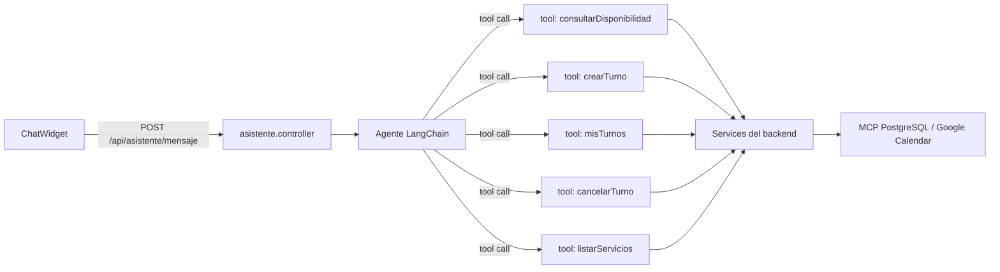

# spec-cu06-chatbot-langchain.md

> **Caso de Uso:** CU-06 — Asistente Conversacional con LangChain
> **Feature:** Chatbot de reservas en lenguaje natural
> **Rol autor:** Arquitecto / Tech Lead
> **Estado:** Backend RAG implementado (AI Engineer): ingesta + chat + endpoints. Pendientes: UI `ChatWidget`, tools de reserva y tests (CA-06.9). Ver sección 8.
> **Metodología:** Spec-Driven Development — ver `IA_WORKFLOW.md` y `SDD.md`

---

## 1. Descripción

Permitir que el cliente interactúe con un asistente conversacional que entiende lenguaje natural y puede **consultar disponibilidad, crear turnos, consultar y cancelar sus turnos y responder preguntas sobre servicios**. El asistente **no duplica la lógica de negocio**: invoca `tools` que llaman a los mismos `services` del backend.

**Actores:** Cliente (primario), Barbero/Admin (opcional).
**Alcance:** agente, tools, memoria y endpoints de chat. **Fuera de alcance:** voz, multiidioma, acciones administrativas por chat.

---

## 2. Arquitectura de la Integración (LangChain ⇄ Backend)

**Principio:** el agente **nunca** accede a la base de datos ni a Google Calendar directamente. Solo usa `tools`; cada `tool` valida su entrada y delega en un `service` del backend (la misma capa que usa la API REST).

**Componentes del agente:**
- **LLM:** modelo de chat configurable (proveedor definido por el Tech Lead).
- **Prompt de sistema (`agent/prompts/system.ts`):** rol de recepcionista, tono cordial, idioma español, reglas de confirmación antes de crear/cancelar un turno, no inventar disponibilidad.
- **Tools (`agent/tools/*`):** funciones tipadas con esquema de entrada/salida.
- **Memoria:** historial de conversación acotado por sesión (buffer/summary memory), con `usuarioId` como contexto de identidad.
- **Orquestación:** agente de tipo *tool-calling*; el resultado de cada `tool` se devuelve estructurado al LLM.

**Seguridad de las tools:**
- Toda `tool` recibe el `usuarioId` de la sesión autenticada; **jamás** lo toma del texto del usuario.
- Las operaciones de escritura (crear/cancelar) requieren **confirmación explícita** del usuario en la conversación.
- Las tools reutilizan las validaciones de los services (no las reimplementan).

---

## 3. Endpoints REST (Node.js)

| Método | Endpoint | Descripción | Autorización |
|--------|----------|-------------|--------------|
| `POST` | `/api/asistente/mensaje` | Envía un mensaje y recibe la respuesta del agente. | Autenticado |
| `GET` | `/api/asistente/historial` | Devuelve el historial de la conversación de la sesión. | Autenticado |
| `DELETE` | `/api/asistente/historial` | Limpia/reinicia la conversación actual. | Autenticado |
| `GET` | `/api/asistente/tools` | Lista las tools disponibles (diagnóstico/debug, solo dev/admin). | Admin |

**Contratos (alto nivel):**
- `POST /api/asistente/mensaje` body → `{ mensaje, sesionId? }` ⇒ `{ respuesta, toolInvocadas[], turnoCreado? }`.
- Errores de tools se traducen a mensajes naturales (ej. "esa franja ya está ocupada").

**Errores esperados:** `400` mensaje vacío, `401` no autenticado, `429` límite de uso, `500` fallo del proveedor LLM (fallback a mensaje de disculpa).

---

## 4. Componentes de UI (Next.js + Tailwind)

| Componente | Ruta propuesta | Descripción |
|------------|----------------|-------------|
| `ChatWidget` | `components/chat/ChatWidget.tsx` | Ventana flotante del asistente. |
| `ChatMessageList` | `components/chat/ChatMessageList.tsx` | Lista de mensajes usuario/asistente. |
| `ChatInput` | `components/chat/ChatInput.tsx` | Campo de texto y envío. |
| `ToolResultCard` | `components/chat/ToolResultCard.tsx` | Render de resultados (turno creado, franjas, etc.). |
| `TypingIndicator` | `components/chat/TypingIndicator.tsx` | Indicador de "escribiendo…". |
| `useAsistente` | `lib/hooks/useAsistente.ts` | Hook para el estado y envío de mensajes. |

**Estados de UI:** enviando, esperando respuesta, error de red, respuesta con turno creado, sugerencias rápidas ("Quiero un corte", "Ver mis turnos").

---

## 5. Criterios de Aceptación

- [ ] **CA-06.1** El cliente puede preguntar por disponibilidad y el agente responde con franjas reales obtenidas del backend.
- [ ] **CA-06.2** El agente puede crear un turno tras confirmación explícita, usando la misma validación que la API (sin solapamientos).
- [ ] **CA-06.3** El agente puede listar y cancelar los turnos del usuario autenticado.
- [ ] **CA-06.4** Las tools usan el `usuarioId` de la sesión y nunca un identificador provisto en el texto.
- [ ] **CA-06.5** Ante un error de negocio (franja ocupada), el agente lo comunica en lenguaje natural.
- [ ] **CA-06.6** Si el proveedor LLM falla, el chat muestra un mensaje de disculpa sin romper la UI.
- [ ] **CA-06.7** El historial de la conversación se conserva durante la sesión y puede reiniciarse.
- [ ] **CA-06.8** El agente responde en español y no inventa servicios ni disponibilidad.
- [ ] **CA-06.9** Existe test del caso feliz y de un caso de error por endpoint (con LLM/tools mockeados).

---

## 6. Dependencias

- Services de reservas, servicios y turnos (CU-02, CU-03, CU-04).
- Proveedor LLM y framework LangChain (config `agent/`).
- Autenticación (CU-01) para el contexto de sesión.

## 7. Riesgos

- Alucinaciones del modelo → mitigar con prompt estricto y tools con salida estructurada.
- Costo/latencia del LLM → cachear catálogo y limitar tamaño de contexto.
- Ejecución indebida de acciones → exigir confirmación antes de escrituras.

---

## 8. Fase 1 implementada (AI Engineer)

**Alcance actual:** asistente RAG de consulta (servicios, precios y horarios) sobre un archivo de conocimiento Markdown, replicando la lógica de `ingest.py` / `chat.py` de la cátedra en el backend Node.js con LangChain.js.

**Componentes:**

| Módulo | Rol |
|---|---|
| `src/agent/embeddings.js` | Embeddings locales `Xenova/all-MiniLM-L6-v2` (vía `@huggingface/transformers`, sin API key). |
| `src/agent/vectorStore.js` | Chunking (500/50), embedding y persistencia `data/vector_db.json` (MemoryVectorStore + JSON). |
| `src/agent/llm.js` | `ChatGroq` / `ChatOllama` según `LLM_PROVIDER`. |
| `src/agent/prompts.js` | Prompt de recepcionista (español, solo contexto). |
| `src/agent/conversations.js` | Historial por conversación en `data/conversaciones/` (JSON). |
| `src/services/asistente.service.js` | Orquestación retriever → prompt → LLM → memoria. |
| `scripts/ingest.js` | Ingesta CLI: `npm run ingest -- data/conocimiento-barberia.md`. |

**Endpoints:** `POST /api/chat` y `POST /api/asistente/mensaje` con body `{ pregunta, sesionId? }` → `{ respuesta, conversacionId, toolInvocadas: [] }` (se acepta `mensaje` como alias de `pregunta`); `GET/DELETE /api/asistente/historial`. `400` sin pregunta, `503` sin base de conocimiento, fallback de disculpa si el proveedor LLM falla.

**Fuente de conocimiento:** `datos_barberia.md` (raíz del repo, definido por `ASISTENTE_DOC`) → `backend/data/vector_db.json`.

**Decisiones de arquitectura (justificadas):**
- **Persistencia JSON + MemoryVectorStore** en vez de un servidor ChromaDB: mismo resultado RAG, cero infraestructura extra; replicable con `chroma_db` si se quiere.
- **Endpoint público** en esta fase (solo responde información pública del local); al agregar tools de reserva (Fase 2) se exigirá sesión autenticada (CA-06.4).
- **Versionado de paquetes:** rama estable LangChain.js `0.3.x` (peers coherentes con `dotenv@18`); la rama `1.x` queda como migración futura.

**Pendientes Fase 2 (spec 3-4):** tools `consultarDisponibilidad/crearTurno/misTurnos/cancelarTurno` delegando en los services existentes, contexto de `usuarioId` de sesión, confirmación antes de escrituras y `ChatWidget` en el frontend.
